# Housing Market Dynamics in the U.S.

**Trends, predictive analytics and forecasting with 25 years of Zillow home values across 894 U.S. metro areas.**

Graduate research project (Creative Component) for the M.S. in Information Systems at Iowa State University, 2025.

🌐 **[Live dashboard](https://codeind.github.io/US-Housing-Market-Dynamics/dashboard/)** · 📄 [Full research report (PDF)](docs/Housing_Market_Dynamics_Report.pdf) · 📊 [Tableau workbook](tableau/Zillow_Housing_Analysis.twbx) · 🎤 [Presentation](docs/MIS599_Presentation.pptx)

---

## Key results

| | |
|---|---|
| Data | Zillow Home Value Index (ZHVI), monthly, **Jan 2000 – Feb 2025**, **894 metro areas** |
| Tableau | **8 visual dashboards**: price trends, YoY and CAGR growth, geospatial maps, volatility, seasonality and post-COVID recovery |
| Forecasting | **24-month Prophet forecasts** per metro |
| Market segmentation | **4 market types** from K-Means clustering (post-COVID growth, volatility, price level, size) |
| Risk screening | Overheated metros flagged with **Z-scores and Isolation Forest** |
| Forecast accuracy | Prices predicted **12 months ahead within about 5% on average** (MAPE 4.8% Linear Regression, 5.0% Random Forest; tested on 2020–2025) |

**Insights from the report**
- **Austin, TX** home values rose **102.6%** from Jan 2014 to Jan 2024, more than double Des Moines' growth, a sign of speculative demand.
- **Des Moines, IA** grew at a steady **4.5% CAGR** (2014–2024) with low volatility.
- Prices **peak between May and July** in most metros and dip in November–December.
- **Ottumwa, IA** had the strongest post-COVID recovery among the Iowa metros compared: **46.26%** (Mar 2020 – Mar 2024).
- Clustering and anomaly detection highlight markets that may be vulnerable to a correction.

---

## Live dashboard

**[Open the interactive dashboard](https://codeind.github.io/US-Housing-Market-Dynamics/dashboard/)** to compare any metros, rank post-COVID growth by state, and explore seasonality, market clusters and state home values. It is built from this repository's data files.

[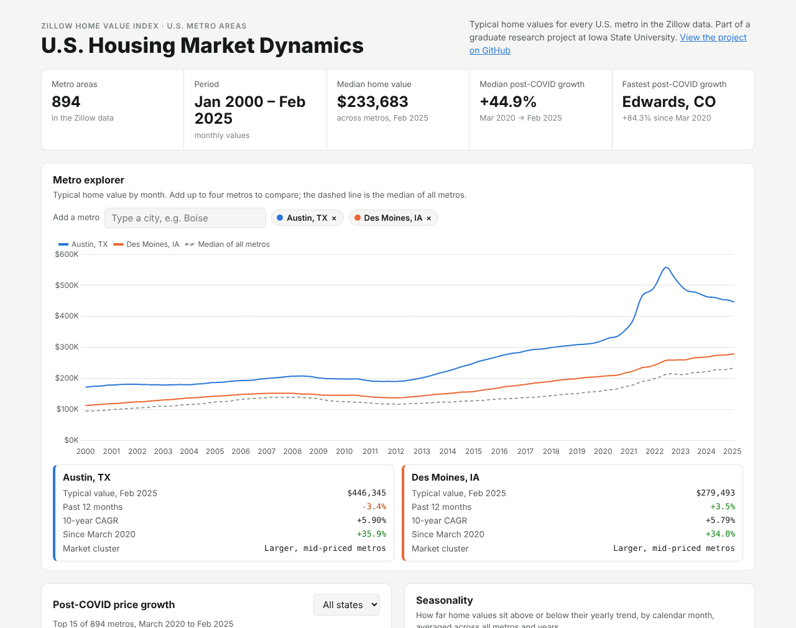](https://codeind.github.io/US-Housing-Market-Dynamics/dashboard/)

---

## Data

- **Source:** [Zillow Research, Home Values (ZHVI)](https://www.zillow.com/research/data/): all homes (single-family and condo), middle price tier, smoothed and seasonally adjusted, metro level. Data provided by Zillow Group.
- **Raw file:** [`data/zillow_zhvi_metro_raw.csv`](data/zillow_zhvi_metro_raw.csv), one row per metro and one column per month.
- **Reshaped file:** [`data/reshaped_zillow.csv`](data/reshaped_zillow.csv), one row per metro per month (long format), built by notebook 01.

The figures quoted in the report use data through **January 2024**. The data in this repository runs to **February 2025**, so recomputing a figure on the full file can give a slightly different value.

## Approach

```
Zillow ZHVI (wide CSV)
   └─ 01 reshape ─► long format: metro × month, city and state split out
        ├─ Tableau ─► 8 dashboards: trends, growth, maps, volatility, seasonality, recovery
        └─ 02 Python ─► Prophet forecasts · Random Forest · K-Means clusters · anomaly detection
              └─ 03 evaluation ─► leak-free, time-based test of Linear Regression vs Random Forest
```

## Tableau dashboards

| | |
|---|---|
| **Price trends, Austin vs Des Moines**<br>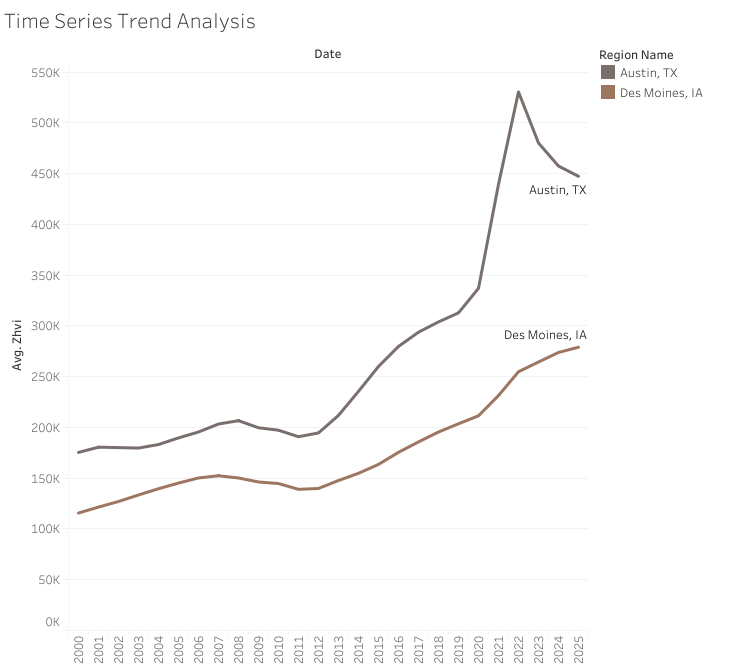 | **Year-over-year and CAGR growth**<br>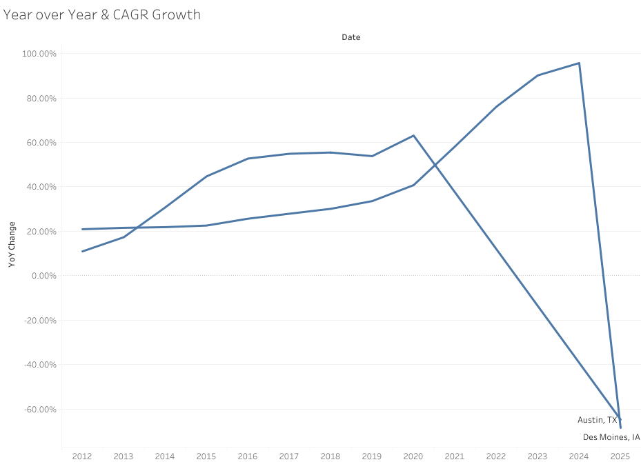 |
| **Average home value by state**<br>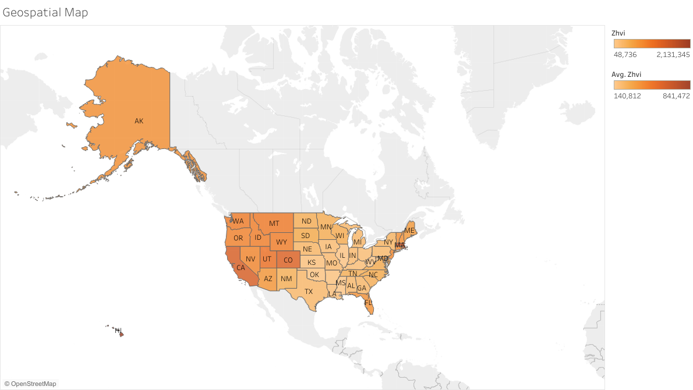 | **Average home value by metro**<br>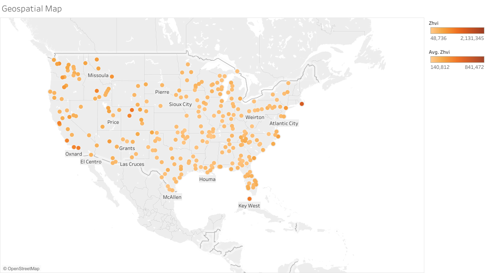 |
| **State heat map**<br>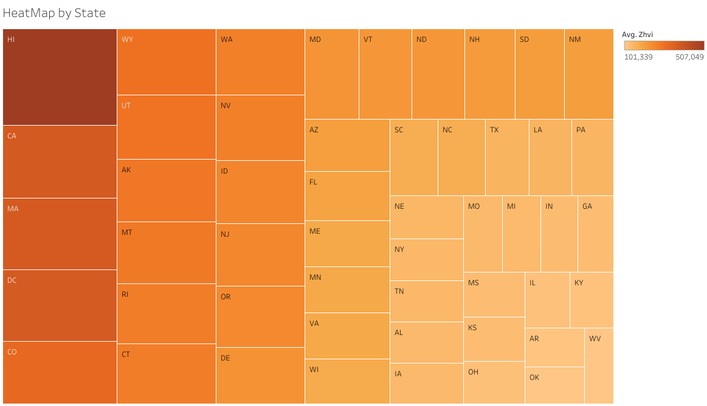 | **Volatility (standard deviation of ZHVI)**<br>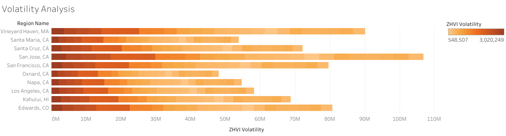 |
| **Monthly trend by year**<br>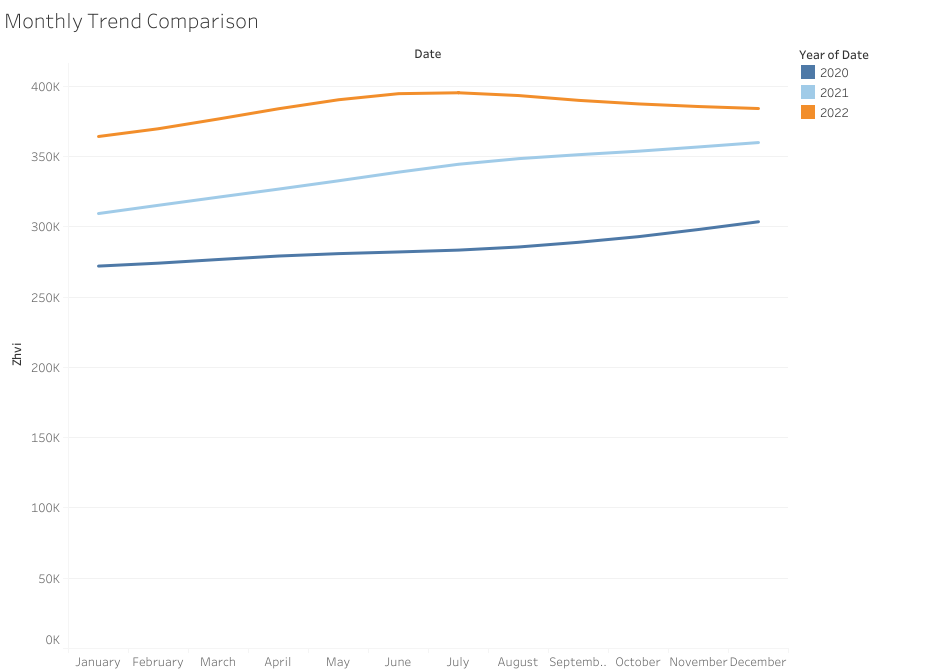 | **Seasonality trend line**<br>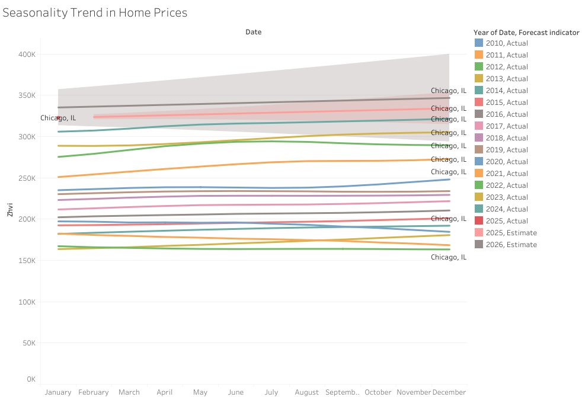 |
| **Post-COVID recovery, Iowa metros**<br>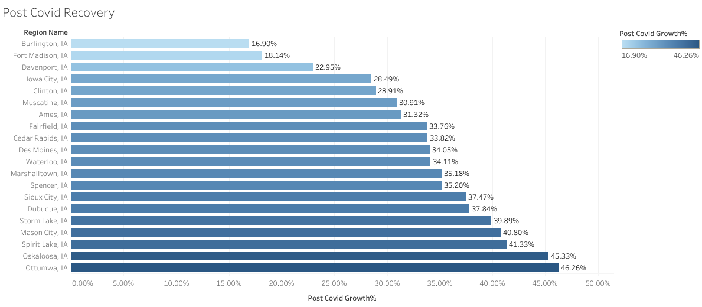 | |

## Forecasting and machine learning

**Prophet forecasts.** A 24-month forecast was produced for each metro; Des Moines is shown below, and [10 more metros](images/forecasts/) are included.

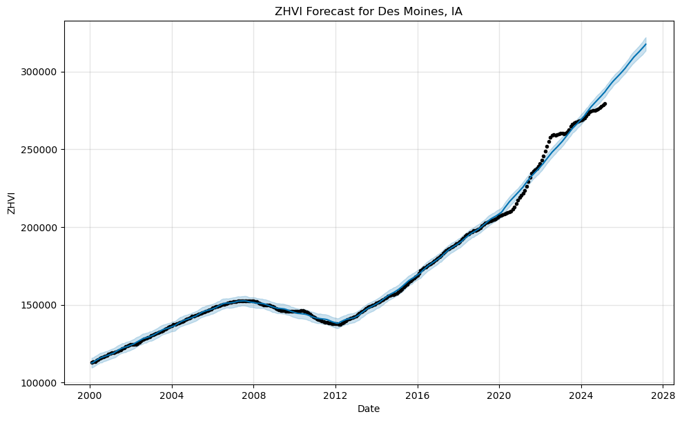

**K-Means market clusters.** Metros were grouped into 4 behavioral types using post-COVID growth, volatility, average price and size rank.

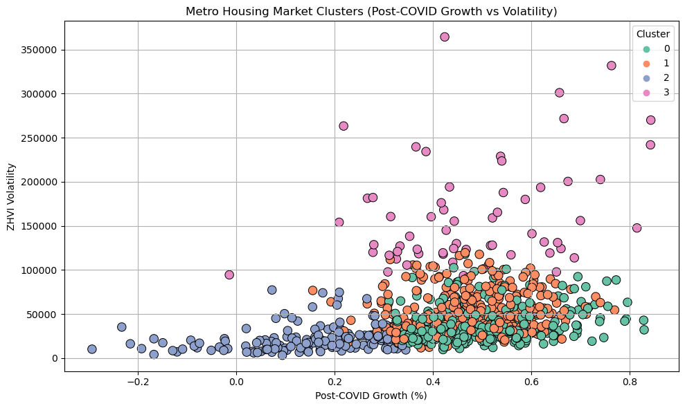

**Anomaly detection.** Z-scores and Isolation Forest flag metros whose post-COVID growth and volatility are unusual, such as Edwards and Steamboat Springs, CO (about 84% growth).

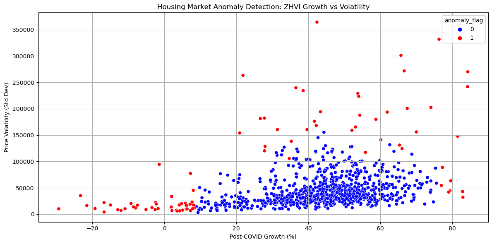

### Model accuracy

[Notebook 03](notebooks/03_model_evaluation.ipynb) tests each model the way a forecast would be used: trained on 2000–2019 and tested on 2020–2025.

| Task | Model | R² | MAE | MAPE |
|---|---|---|---|---|
| 12 months ahead | Linear Regression | 0.980 | $12,749 | **4.84%** |
| 12 months ahead | Random Forest | 0.971 | $13,834 | **5.02%** |
| 1 month ahead | Linear Regression | 1.000 | $619 | 0.26% |
| 1 month ahead | Random Forest | 0.994 | $1,865 | 0.45% |

Predicting next month's value is easy because home values move slowly, so the **12-months-ahead** result is the meaningful measure. Linear Regression does slightly better than Random Forest there, because tree models cannot predict above the price range they were trained on and many metros passed their 2000–2019 levels after 2020.

**About the original R² of 0.9997.** Notebook 02 reported R² 0.9997 for a Random Forest. That score is inflated: its 3-month rolling-average feature includes the current month, so the value being predicted is part of the inputs, and the random train/test split mixes months from the same period. The original output is kept unchanged, with a note, and notebook 03 shows the corrected evaluation.

## Limitations

- ZHVI is a smoothed, seasonally adjusted index of typical home values, not individual sales prices.
- Models use price history, location and calendar features only; interest rates, income and inventory are not included.
- Prophet forecasts assume past trend and seasonality continue, so they do not anticipate shocks.

## How to run

```bash
pip install -r requirements.txt
cd notebooks
jupyter notebook
```

Run the notebooks in order. Notebook 01 rebuilds `data/reshaped_zillow.csv` from the raw file. Notebook 02 writes `data/prepared_ml_zillow_data.csv` before using it (a zipped copy is included). The Tableau workbook opens in Tableau Desktop or the free Tableau Public app. To rebuild the web dashboard's data after changing `data/`, run `python dashboard/build_data.py` from the repository root.

## Repository structure

```
├── data/
│   ├── zillow_zhvi_metro_raw.csv        Zillow ZHVI download (wide format)
│   ├── reshaped_zillow.csv              long format, used by Tableau and Python
│   ├── prepared_ml_zillow_data.csv.zip  features for the Random Forest (notebook 02)
│   └── clustered_metro_housing.csv      K-Means cluster per metro
├── notebooks/
│   ├── 01_reshape_zillow_data.ipynb
│   ├── 02_forecasting_and_ml.ipynb      Prophet, Random Forest, clustering, anomalies
│   └── 03_model_evaluation.ipynb        leak-free, time-based evaluation
├── tableau/Zillow_Housing_Analysis.twbx 8 dashboards
├── dashboard/                           interactive web dashboard (GitHub Pages) and its data builder
├── images/                              tableau/, forecasts/, models/
├── docs/                                research report and presentation
└── requirements.txt
```

## Academic context

Creative Component submitted to the graduate faculty of Iowa State University in partial fulfillment of the requirements for the degree of Master of Science in Information Systems (2025). Major professor: Dr. Anthony M. Townsend.

## References

1. Bello, M. Z., Sanni, M. L., & Mohammed, J. K. (2020). Conventional methods in housing market analysis: A review of literature. *Baltic Journal of Real Estate Economics and Construction Management*, 8, 227–241. https://doi.org/10.2478/bjreecm-2020-0016
2. Grybauskas, A., Pilinkienė, V., & Stundžienė, A. (2021). Predictive analytics using Big Data for the real estate market during the COVID-19 pandemic. *Journal of Big Data*, 8, 105. https://doi.org/10.1186/s40537-021-00476-0
3. Moreno-Foronda, I., Sánchez-Martínez, M.-T., & Pareja-Eastaway, M. (2025). Comparative analysis of advanced models for predicting housing prices: A review. *Urban Science*, 9(2), 32. https://doi.org/10.3390/urbansci9020032

Full reference list in the [report](docs/Housing_Market_Dynamics_Report.pdf).
